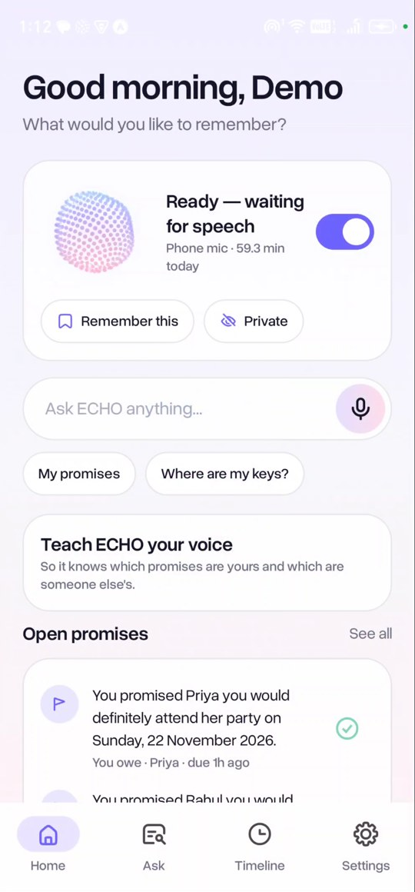
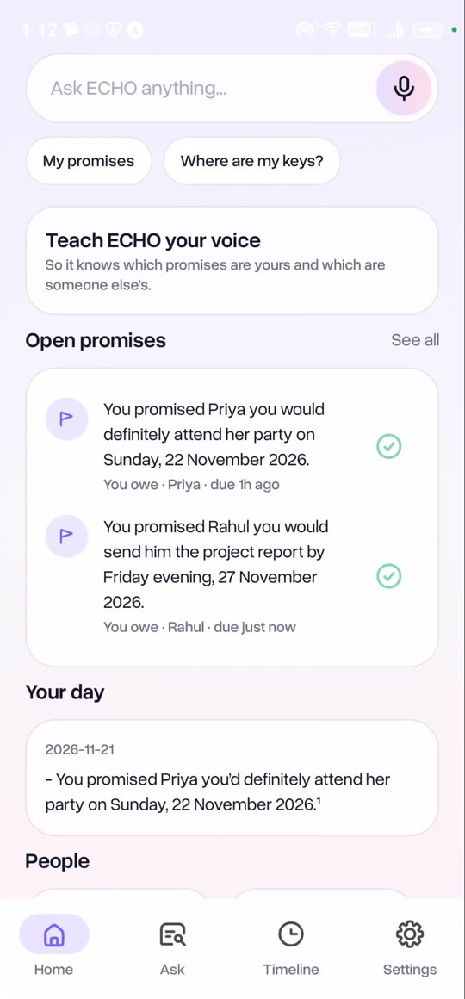
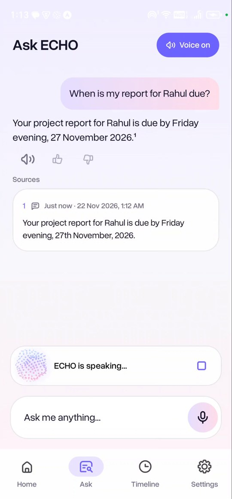
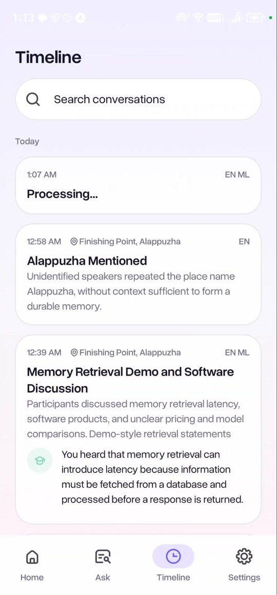
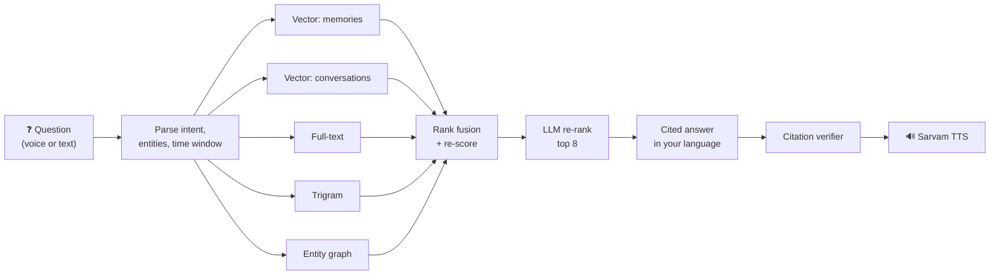
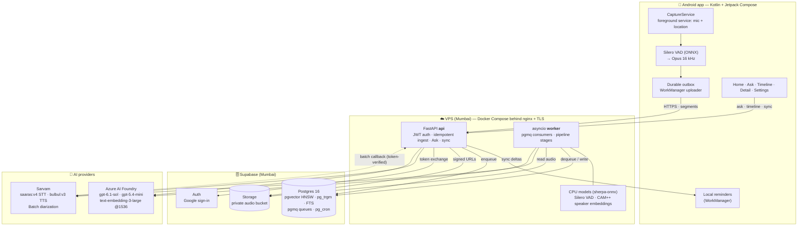

<div align="center">

# ECHO

### Your external memory. It listens through your day and answers with proof.

**Ask "When is my report for Rahul due?" and get the answer, with the exact moment you said it.**

[](https://github.com/n88vd/ECHO/actions/workflows/ci.yml)


&nbsp;
&nbsp;
&nbsp;


**Live API:** [`echo.nmrlabs.space`](https://echo.nmrlabs.space/readyz) &nbsp;·&nbsp; **Architecture:** [docs/ARCHITECTURE.md](docs/ARCHITECTURE.md) &nbsp;·&nbsp; **API:** [docs/API.md](docs/API.md)

</div>

---

## Contents

- [The problem](#the-problem)
- [Our solution](#our-solution)
- [Key features](#key-features)
- [Screenshots](#screenshots)
- [How it works](#how-it-works)
- [Architecture](#architecture)
- [Tech stack](#tech-stack)
- [Getting started](#getting-started)
- [API overview](#api-overview)
- [Privacy and safety](#privacy-and-safety)
- [Engineering highlights](#engineering-highlights)
- [Roadmap](#roadmap)
- [Repository layout](#repository-layout)

---

## The problem

People forget most of what they hear within a day. That includes the things that matter: a promise to a friend, a deadline from a manager, the name of the person you met, where you left your passport.

The tools we have today don't solve this:

- **Notes apps need you to stop and type.** Nobody does that in the middle of a conversation.
- **Meeting recorders only work in meetings.** Most important moments happen in a corridor, a kitchen or an auto-rickshaw.
- **Voice assistants handle only English and keep no memory.** In India, real conversations switch between Hindi, Tamil, Malayalam and English in the same sentence.
- **Raw transcripts are not memory.** Hours of text you can't search are no more useful than nothing.
- **Generic chatbots make things up.** When the question is "what did I promise?", an answer you can't check is worse than no answer.

## Our solution

**ECHO is a personal memory system.** An Android app captures speech (only speech) through the day. A backend pipeline turns it into structured memories you can check. You ask questions in your own language, by voice or text, and ECHO answers **with a citation for every fact**.

| | Before ECHO | With ECHO |
|---|---|---|
| Capture | Type notes by hand, or forget | Hands-free, speech-only capture with on-device voice detection |
| Languages | English only | English + 22 Indian languages, code-mixed speech supported |
| Organisation | A heap of transcripts | Facts, events, promises, decisions, people and places, linked together |
| Recall | Scroll and search | "Where did I keep my keys?" answered in seconds |
| Trust | "The AI said so" | Every claim links to the exact utterance, speaker and time |
| Follow-through | Promises forgotten | Promises tracked and reminders scheduled automatically |

If ECHO doesn't know, it says **"I don't have a memory of that"**. It doesn't guess.

---

## Key features

### 🎙️ Always-ready, speech-only capture
- **On-device voice activity detection** (Silero VAD). Silence never leaves the phone, which saves battery, data and cost.
- Works with the **phone mic or Bluetooth earbuds**. It switches source only at silence boundaries and respects music playback.
- **Never records phone calls**, including WhatsApp and Meet calls.
- **Private mode** and **Quiet Hours** pause capture with one tap. A visible orb always shows the capture state.
- **Offline-first outbox:** audio is Opus-encoded, kept in app-private storage until the upload is confirmed, and uploaded with idempotent retries, so you never lose a moment or get a duplicate.

### 🧠 Memories, not transcripts
- A language model extracts **typed memories**: facts, events, **commitments**, decisions, ideas, learnings, object locations, people info.
- **Grounding check:** every memory must cite real utterances, and its key nouns must appear in them, or it is dropped.
- **Entity graph:** people, places and objects are resolved across languages and scripts ("राहुल" = "Rahul").
- **Supersession:** "I moved my passport to the drawer" replaces the older location. ECHO answers with the latest fact.
- **Speaker identification:** teach ECHO your voice once. It then knows which promises are yours and which are someone else's. Name other speakers ("This is Priya") and it updates past conversations too.

### 🔎 Ask ECHO, with receipts
- Ask **by voice or text, in any supported language**. Answers come back in your language, spoken aloud if you like.
- **Five-way hybrid retrieval:** two vector searches, full-text, trigram (names and transliterations) and an entity-graph search, fused with Reciprocal Rank Fusion, then re-ranked by an LLM.
- **Citation verifier:** each sentence must cite a memory it was given. Anything without support is removed before you see it.
- Tap a source to see the original quote, the speaker, the time and the place.

### ⏰ Proactive follow-through
- **Open promises** on Home: "You promised Rahul you would send the project report by Friday evening."
- **Reminders** are created from commitments and scheduled locally on the device. No Firebase, no push servers.
- **Daily digest** of your day: conversations, decisions, new people and open promises.
- **People profiles:** last interaction, topics and open commitments in both directions.

### 📍 Context that helps recall
- Each conversation is tagged with its **place** (geocoded on the device) and its **languages**.
- Detects travel, so "the idea I had while travelling" works.
- **"Remember this":** a button, a notification action, a Quick Settings tile, or just say *"ECHO, remember this"* / *"ECHO, yaad rakhna"*. That moment gets priority and the most accurate processing.

---

## Screenshots

<table>
  <tr>
    <td align="center" width="25%"><br/><b>Home</b><br/><sub>Live capture state, Remember this, Private mode, quick asks</sub></td>
    <td align="center" width="25%"><br/><b>Open promises</b><br/><sub>Commitments pulled from conversations, with who and when</sub></td>
    <td align="center" width="25%"><br/><b>Ask ECHO</b><br/><sub>Spoken answer with a numbered, timestamped source</sub></td>
    <td align="center" width="25%"><br/><b>Timeline</b><br/><sub>Summarised conversations with place and language tags</sub></td>
  </tr>
</table>

> Screenshots are taken from a real screen recording on an HONOR X9b (Android 15) against the production backend.

---

## How it works


**Ask ECHO:**



---

## Architecture



**Design principles**

1. **One database is the system of record.** Postgres holds the data, the job queue (pgmq), the schedules (pg_cron) and the vectors (pgvector). A job can't be lost after its row is written, because both commit in the same transaction.
2. **Every stage is idempotent and can run again.** Client-generated UUIDv7 segment IDs and keyed upserts make retries safe.
3. **Providers sit behind interfaces.** STT, TTS, LLM and embeddings can be swapped. `PROVIDERS=fake` runs the whole pipeline with **zero API spend**.
4. **Cheapest filter first.** On-device VAD → server blank filter → transcript QA, all before any LLM call.
5. **The VPS is stateless.** If it goes down, the phone's outbox buffers audio. An outage means a delay, not data loss.

The full design, the decision log and the data model are in **[docs/ARCHITECTURE.md](docs/ARCHITECTURE.md)**.

---

## Tech stack

| Layer | Technology |
|---|---|
| **Mobile** | Kotlin 2.4, Jetpack Compose, Material 3, WorkManager, file-based outbox, Android Keystore (AES-GCM token storage), Credential Manager (Google sign-in), Fused Location + on-device Geocoder, ONNX Runtime (Silero VAD), MediaCodec Opus |
| **API** | Python 3.12, FastAPI, Pydantic v2, asyncpg, httpx, uvicorn |
| **Worker** | asyncio queue consumers, sherpa-onnx (Silero VAD, 3D-Speaker CAM++ voiceprints), PyAV / libsndfile decoding, agglomerative speaker clustering, DBSCAN place clustering |
| **Database** | Supabase Postgres 16, **pgvector** (HNSW, cosine), **pg_trgm**, `tsvector` FTS, **pgmq** queues, **pg_cron** schedules, row-level security |
| **Storage / Auth** | Supabase Storage (private bucket, signed URLs), Supabase Auth (Google ID token exchange) |
| **Speech** | Sarvam AI `saaras:v4` (REST + Batch with diarization), `bulbul:v3` text-to-speech |
| **Language models** | Azure AI Foundry: `gpt-6.1-sol` (understanding, answers), `gpt-5.4-mini` (query parsing, titles), `text-embedding-3-large` at 1536 dims |
| **Infra** | Docker Compose, nginx + certbot TLS, Mumbai region (VPS and DB about 5 ms apart) |
| **Quality** | Ruff, pytest (unit, real-DB E2E with fake AI, live E2E), GitHub Actions CI (lint, tests, Android debug build) |
| **Design** | Figma icon set, animated dot-sphere orb, Overused Grotesk typeface (SIL OFL) |

---

## Getting started

### Prerequisites

- Python 3.12 and [`uv`](https://docs.astral.sh/uv/)
- A Supabase project with the `pgvector`, `pg_trgm`, `pgmq` and `pg_cron` extensions available
- Android Studio (JBR 21) and an Android 10+ phone, for the app
- Optional, for live mode: a Sarvam AI API key and an Azure AI Foundry resource

### 1. Backend

```bash
git clone https://github.com/n88vd/ECHO.git
cd ECHO/backend
uv sync
cp .env.example .env        # then fill in your values
```

Download the two on-device models into `backend/models/` (the URLs and SHA-256 values are in the [`Dockerfile`](backend/Dockerfile)):

```bash
mkdir -p models
curl -fsSL -o models/silero_vad.onnx https://github.com/k2-fsa/sherpa-onnx/releases/download/asr-models/silero_vad.onnx
curl -fsSL -o models/campplus_en_voxceleb.onnx https://github.com/k2-fsa/sherpa-onnx/releases/download/speaker-recongition-models/3dspeaker_speech_campplus_sv_en_voxceleb_16k.onnx
```

Apply the database migrations (with `DATABASE_URL` set to the `postgres` role):

```bash
./scripts/db_migrate.sh
```

Run the API and the worker in two terminals:

```bash
PROVIDERS=live uv run uvicorn app.main:app --port 8000
```

```bash
PROVIDERS=live uv run python -m app.workers.runtime
```

Use `PROVIDERS=fake` to run the full pipeline with deterministic stubs and no API spend. Check that the API is up:

```bash
curl http://localhost:8000/readyz
```

**Or with Docker** (the production setup: `api` + `worker`, live providers, API on `127.0.0.1:8070`):

```bash
docker compose up --build -d
```

### 2. Tests

```bash
uv run ruff check app tests                                         # lint
uv run pytest -q                                                    # unit tests, no network
ECHO_DB_TESTS=1 uv run pytest tests/test_e2e_db.py -q               # real Supabase, fake AI
ECHO_LIVE_TESTS=1 PROVIDERS=live uv run pytest tests/test_live.py -s # real Sarvam + Azure (spends credits)
```

### 3. Android app

```bash
cd android
./gradlew assembleDebug                     # points at the production API
```

To use your local API on a USB-connected phone:

```bash
./gradlew assembleDebug -PECHO_DEBUG_API_BASE_URL=http://localhost:8000
```

```bash
adb reverse tcp:8000 tcp:8000
```

For release builds, Google sign-in setup and deployment, see **[docs/OPERATIONS.md](docs/OPERATIONS.md)**.

### Key environment variables

| Variable | Purpose |
|---|---|
| `ECHO_DATABASE_URL` | Runtime Postgres connection (a role with limited permissions) |
| `DATABASE_URL` | `postgres` role connection, used only for migrations |
| `SUPABASE_URL`, `SUPABASE_SERVICE_ROLE_KEY`, `SUPABASE_JWT_ISSUER` | Supabase storage and auth |
| `AZURE_OPENAI_BASE_URL`, `AZURE_OPENAI_API_KEY` | Azure AI Foundry endpoint |
| `LLM_DEPLOYMENT_REASONING`, `LLM_DEPLOYMENT_FAST`, `EMBEDDING_DEPLOYMENT`, `EMBEDDING_DIMENSIONS` | Model deployments |
| `SARVAM_API_KEY` | Speech-to-text and text-to-speech |
| `PROVIDERS` | `fake` \| `live` |
| `SARVAM_DAILY_BUDGET_INR` | Global daily spend cap (default ₹150) |

---

## API overview

All endpoints are under `/v1` and need `Authorization: Bearer <supabase access token>`, except auth and health. The full request and response reference is in **[docs/API.md](docs/API.md)**. FastAPI also serves interactive docs at `/docs` when you run it locally.

| Area | Endpoints |
|---|---|
| **Auth** | `POST /v1/auth/google` · `POST /v1/auth/refresh` · `POST /v1/auth/password` |
| **Ingest** | `POST /v1/devices` · `POST /v1/segments` · `POST /v1/segments/init` · `POST /v1/segments/{id}/commit` · `POST /v1/remember` |
| **Status & sync** | `GET /v1/status` · `GET /v1/sync` · `POST /v1/reminders/{id}/delivered` |
| **Ask** | `POST /v1/ask` · `POST /v1/ask/voice` · `POST /v1/ask/{id}/feedback` |
| **Memories** | `GET /v1/timeline` · `GET/PATCH/DELETE /v1/memories/{id}` · `GET/DELETE /v1/conversations/{id}` · `POST /v1/speakers/{id}/label` |
| **People & promises** | `GET /v1/people` · `GET /v1/people/{id}` · `GET /v1/commitments` · `PATCH /v1/commitments/{id}` |
| **Digests** | `GET /v1/digests/latest` · `GET /v1/digests/{day}` |
| **Account** | `GET/PATCH /v1/settings` · `POST/DELETE /v1/voiceprint` · `GET /v1/export` · `DELETE /v1/account` |
| **Health** | `GET /healthz` · `GET /readyz` |

**Example: ask a question**

```bash
curl -X POST https://echo.nmrlabs.space/v1/ask \
  -H "Authorization: Bearer $TOKEN" -H "Content-Type: application/json" \
  -d '{"query": "When is my report for Rahul due?", "speak": false}'
```

```json
{
  "ask_id": "0193…",
  "answer": "Your project report for Rahul is due by Friday evening, 27 November 2026. [m:0193…]",
  "answer_language": "en-IN",
  "citations": [
    {
      "id": "0193…",
      "kind": "memory",
      "type": "commitment",
      "content": "You promised Rahul you would send him the project report by Friday evening, 27 November 2026.",
      "captured_at": "2026-11-22T01:12:04+05:30",
      "conversation_id": "0193…",
      "evidence": [{ "speaker": "You", "quote_en": "I'll send you the project report by Friday evening." }]
    }
  ],
  "tts_url": null,
  "latency_ms": 7840
}
```

---

## Privacy and safety

Recording speech is sensitive. Privacy is part of ECHO's design, not an extra.

- **Consent first:** capture starts only after explicit permission and an in-app disclosure. A persistent notification and the orb always show the state.
- **Speech only:** silence and non-speech never leave the device. Blank or noise-only audio is deleted on the server at once.
- **No phone calls, ever.**
- **Secrets are redacted** (OTPs, card numbers, passwords, Aadhaar-like numbers) before anything is stored or embedded.
- **Row-level security** on every table. The `user_id` comes only from the verified JWT. The app never holds a Supabase key.
- **You choose how long raw audio is kept:** delete after processing, 7, 30 or 90 days, or forever.
- **You own your memory:** edit or delete any memory or conversation, **export everything**, or **delete your account** (DPDP Act 2023).
- **Data stays in India:** the database, storage and API all run in Mumbai.
- **Budget guardrails:** every provider call is logged in a cost ledger, with global and per-user daily caps. Work over the budget is delayed, never dropped.

---

## Engineering highlights

- **Two-path STT on a budget.** Each segment is transcribed once over REST. Speakers are clustered on the server with CAM++ embeddings. The more expensive Sarvam Batch diarization runs only for "Remember this" moments.
- **Fewer billed seconds.** Speech is re-encoded to 16 kHz WAV with silence compacted before STT.
- **1536-dim Matryoshka embeddings.** `text-embedding-3-large` is truncated to fit pgvector's HNSW limit with almost no loss in quality.
- **Lightweight worker.** Silero and CAM++ run through sherpa-onnx with no PyTorch. The worker uses about 250 MB of RAM.
- **Recovers from lost jobs.** Pinned conversations whose batch STT request was lost are detected and resubmitted.
- **Tested end to end:** unit tests, a real-database E2E with fake AI, and a live E2E across English, Hindi, Tamil and Hinglish (Batch diarization, a Hindi spoken answer, and the "don't know" answer). Also tested with real capture on an Android 15 phone uploading to production.

---

## Roadmap

- [ ] Streamed answers (SSE) to cut Ask latency from about 8 s to under 3 s for the first token
- [ ] Regional Azure deployment in India
- [ ] Golden-set evaluation harness in CI (Recall@8, citation validity, hallucination rate)
- [ ] Never-record geofences
- [ ] Audio clip playback seeked to the cited utterance
- [ ] Play Store launch

---

## Repository layout

```
ECHO/
├── android/                  Kotlin + Jetpack Compose app (minSdk 29)
├── backend/
│   ├── app/
│   │   ├── api/              FastAPI routers and schemas
│   │   ├── audio/            decoding, VAD, quality checks
│   │   ├── core/             config, auth, db pool, costs, storage
│   │   ├── pipeline/         stitch → STT → QA → speakers → understand → entities → embed → proactive
│   │   ├── retrieval/        query parsing, hybrid search, fusion, re-rank, cited answers
│   │   ├── providers/        Sarvam / Azure adapters and fakes
│   │   ├── prompts/          versioned prompts and JSON schemas
│   │   └── workers/          pgmq consumer runtime
│   ├── supabase/migrations/  schema, RLS, queues, cron, storage
│   ├── deploy/               deploy script and nginx config
│   └── tests/
├── docs/
│   ├── ARCHITECTURE.md       design and decision log
│   ├── API.md                API reference
│   ├── OPERATIONS.md         runbook: deploy, release, launch checklist
│   └── screenshots/
└── .github/workflows/ci.yml  lint, tests, Android build
```

---

<div align="center">

**ECHO: never forget a thing.**

Built with ❤️ in India.

</div>
